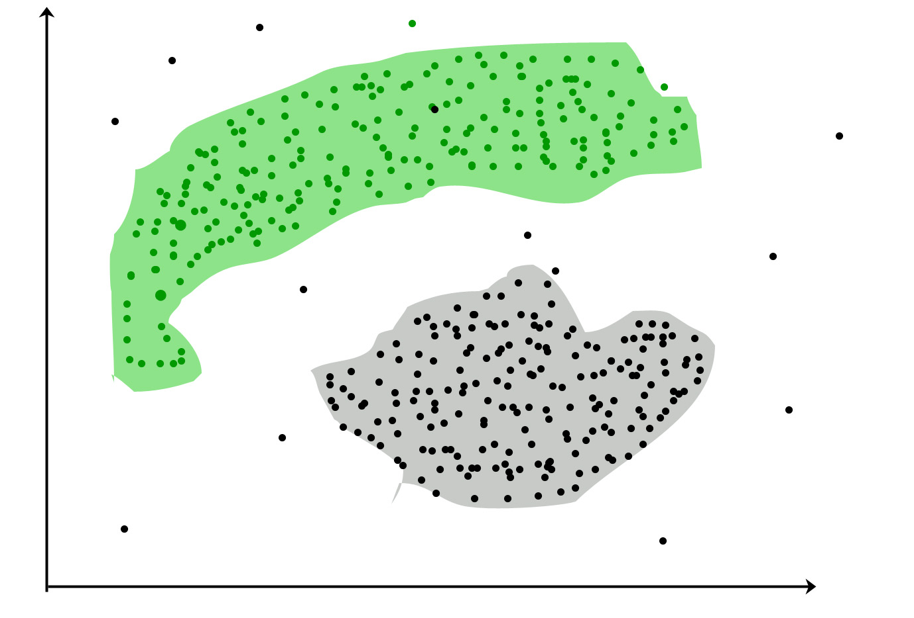

# Scratch network
Deep learning made from scratch without "machine learning librairies".

- V0.1: Creation of a blank canvas window
- V0.2: Updates of the canvas based on shapes
- V0.2.1: Creation of random shapes
- V0.3: Modification of the canvas based on a selector window with mouse and keyboard listeners
- V0.3.1: Saving of levels
- V0.3.2: Helpers
- V0.4: Sampler based on knn algorithm
- [V0.5](https://github.com/PyrDeus/Return-to-basis---Scratch-Neural-Nework/tags): First agent learning.

# TODO
- Visualization of the neural network function on the canvas
- Visualisation of the "zone of influence"
- Enhance the dnn agent

# Run
To create new levels:
> python create_level.py

To train the agent:
> python run.py

# Misc
- Visualization of the nn function could be done with callback function
- Samples could be seen as "training" / "validation" / "testing"
- Currently working on another project (LLM)

# Illustrations
Goal of Classification and Clustering:
{width=75%}

---

# License

This project is licensed under the GNU General Public License version 3 (GPLv3) for personal, educational, or non-commercial use.

Commercial use, including use by companies, requires a separate proprietary license. Please contact verheeke.sacha@gmail.com for licensing inquiries.

